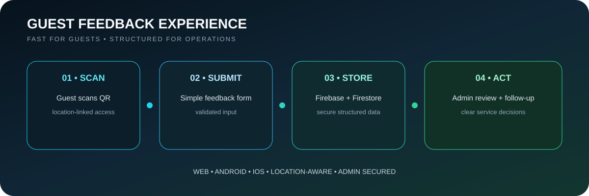

<p align="center">
  
</p>

<p align="center"><b>QR-based guest feedback • secure admin management • web + mobile</b></p>

<p align="center">
  
  
  
</p>

## ✦ Experience Flow

<p align="center">
  
</p>

## ✦ Hospitality Context

<div align="center">
<table>
<tr>
<td align="center" width="55%"></td>
<td align="center" width="45%"></td>
</tr>
</table>
</div>

## What It Does

Guests scan a location QR code, submit structured feedback, and receive a private confirmation. Administrators review responses securely and use the data for service follow-up.

### Main Features
- QR access linked to location and zone
- Multi-step validated feedback form
- Secure Firebase Authentication + Firestore rules
- Protected admin management area
- Email notifications
- Responsive web experience
- Android and iOS support through Capacitor

## Why This Project Matters

- Makes guest feedback quick and low-friction
- Converts comments into structured operational data
- Keeps management data private while allowing public submission
- Supports one React codebase across web and mobile

## Repository Context

This is a **forked/collaborative codebase**. Individual contribution should be discussed using commit and collaboration history rather than presenting the full codebase as single-author work.

## Run Locally

```bash
npm install
npm run dev
```

Copy `.env.example` to `.env` and add Firebase configuration.

---

<p align="center"><b>Guest input → structured data → better service decisions.</b></p>
